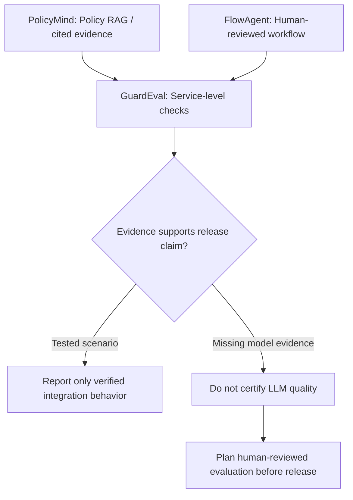

# AI Automation Product Management — Engineering Portfolio

**From AI product strategy to demonstrable controls for trustworthy automation.**

This portfolio connects three **independent, public, reproducible prototypes** addressing a recurring AI product-management challenge: delivering useful AI capabilities without treating impressive outputs as verified business outcomes.

> **Scope and truth standard:** These repositories are independent portfolio work, not company deployments. No customer adoption, revenue, time savings, production security certification, or generalized LLM accuracy is claimed. The CI evidence uses real services with a *small synthetic dataset and extractive generation*, not a credentialed generative-model study.

## Explore the projects

| Project | Product problem | What the prototype demonstrates | Product-owner decision |
| --- | --- | --- | --- |
| **[PolicyMind](https://github.com/reddydev-ai/policymind)** | Policy questions need credible source evidence | PDF ingestion, retrieval, cited answers and restricted evaluation evidence | Prefer traceability and policy freshness over unsupported fluency |
| **[FlowAgent](https://github.com/reddydev-ai/flowagent)** | Vendor processes need structure and accountable decisions | Document-completeness checks, deterministic risk floor, LangGraph pause/resume and reviewer protection | Automate preparation; retain human approval for consequential actions |
| **[GuardEval](https://github.com/reddydev-ai/guardeval)** | Green smoke tests can mislead AI release decisions | Running-service integration, source/citation checks, approval integrity, fail-closed judge validation | Separate tested behavior from unmeasured model quality |

## How they fit together

### Verification that can be checked today

- **Running-service integration:** [GitHub Actions](https://github.com/reddydev-ai/guardeval/actions/workflows/live-integration.yml) starts isolated PolicyMind and FlowAgent services and executes **five synthetic RAG** plus **six synthetic approval/workflow** scenarios.
- **Quality-test contract:** [GuardEval tests](https://github.com/reddydev-ai/guardeval/tree/main/tests) include integrity checks that reject missing contexts, unauthorized actions, incomplete judge results and false-green score aggregation.
- **Evaluation design:** [30 draft synthetic scenarios](https://github.com/reddydev-ai/guardeval/blob/main/evaluation/catalogue_v1.jsonl) spanning correct answers, refusals, conflicts, prompt injection, freshness and approvals. **These cases are not independently reviewed and have not been scored as a held-out model benchmark.**
- **Secure-by-default constraints:** Private APIs, opt-in restricted evaluation evidence, independent demo credentials and [production go/no-go checklist](https://github.com/reddydev-ai/guardeval/blob/main/docs/SECURITY_AND_DEPLOYMENT_DECISION.md).

## Product decision record

| Decision | Why it matters to a product leader |
| --- | --- |
| **Keep document citations visible** | Product trust is about evidence a user can check, not just a polished model response |
| **Separate preparation from approval** | A deterministic rule and an accountable human decision are better suited to consequential workflows |
| **Fail closed on unsupported evaluation metrics** | Teams need defensible release decisions; missing scores must not be treated as green |
| **Keep live demo infrastructure private** | A public backend would introduce security and privacy risks before multi-user access controls exist |
| **Choose a CA$0 testing mode** | Demonstrate reproducibility without pretending paid model-quality studies were performed |

## What I would measure in a real rollout

These are **proposed KPIs, not achieved results**:

- **Customer/user outcome:** task-success rate, median time to verified answer, weekly active usage, feedback resolution time
- **Quality/trust:** unsupported material claim rate, source-page correctness, abstention accuracy and severe incident counts
- **Automation governance:** human override rate, erroneous approvals, exception queue time and replay rejection
- **Business value:** staff minutes saved against an observed baseline, operating cost per successful task, and total cost of ownership

## Risks that remain open

Real generative-LLM evaluation, independently reviewed holdout data, prompt-injection resilience, user-level identity and document ACLs, safe file processing, observability and incident response **are not completed**. Those are go/no-go conditions for production.

## A short recruiter/interview walkthrough

Start with the [7-minute narrative](https://github.com/reddydev-ai/guardeval/blob/main/docs/INTERVIEW_WALKTHROUGH.md), then inspect one product decision per repository. The aim is to explain *what problem was prioritized, what was built, what was independently verified, what remains unknown and why*.

**Technical evidence and implementation:** [PolicyMind](https://github.com/reddydev-ai/policymind) · [FlowAgent](https://github.com/reddydev-ai/flowagent) · [GuardEval](https://github.com/reddydev-ai/guardeval)

*Last substantive portfolio audit: November 2026. GitHub Actions reflects the actual current check status.*
