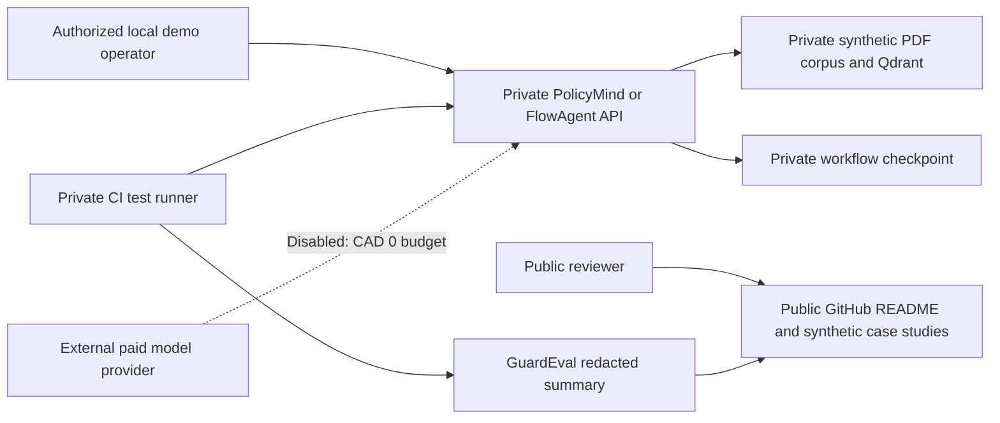

# GuardEval + PolicyMind + FlowAgent — Deployment and Security Decision

**Decision:** Publicly publish **only documentation, synthetic fixtures and source code**. Keep Python APIs, Streamlit review interfaces, Qdrant stores, secret-bearing settings and the evidence-disclosure endpoint restricted to isolated local/test environments. **Approved model API spending: CAD $0.**

**Why:** A public backend would increase privacy and security risk without proving product adoption or increasing model-quality evidence. The current code is a technical portfolio prototype with shared-key demonstration controls, not a production identity/access architecture.

## System trust boundaries

## Primary threats and controls

| Threat / failure | Existing demonstrated control | Residual gap / release blocker |
| --- | --- | --- |
| Unauthorized policy queries or document ingestion | Shared API key for controlled demos | User identity, least privilege and document-level ACLs absent |
| Exposure of retrieved policy text | Evaluation evidence route disabled by default; independent evaluation key | No tenant separation or mature service-to-service identity |
| Untrusted PDF documents | Upload size and file-signature checks | Malware/active-content sandbox, robust parser isolation, data retention and quarantine absent |
| Injection in retrieved text | Strict evaluation design backlog proposes challenge cases | No verified broad adversarial defense; never authorize tools solely from retrieved text |
| Stale or duplicated policy answers | Stable chunk IDs, same-source version replacement tests | Deletion lifecycle, race conditions, migration and distributed consistency unverified |
| Unauthorized or repeated human approval | Separate reviewer key and replay tests | Identity-aware audit log, rotation, concurrency/idempotency at scale absent |
| False-green quality report | Validation requires actual evidence and complete finite judge scores | No independently reviewed held-out dataset or real paid LLM experiment |
| Data or secret leakage in CI | Synthetic fixtures, redacted published result | End-to-end production data-loss prevention and observability not verified |
| Availability, abuse and cost spikes | Local-only default; zero-budget model path | Rate limiting, quotas, token budgets, cloud infrastructure and SLOs absent |

## Production-release go/no-go checklist
A production deployment must satisfy **all**, not just CI:

- [ ] Explicit service owner, data classification, privacy review and user authorization model
- [ ] Identity-aware SSO/OIDC, role-scoped authorization and document ACLs
- [ ] Secret manager, credential rotation, audit logging and separation of privileges
- [ ] Isolated/sandboxed PDF ingestion; resource quotas, request limits and malware controls
- [ ] Tested deletion, retention, version conflicts, transactions and recovery
- [ ] Threat-modelled prompt-injection handling and no unsafe external actions
- [ ] Human-reviewed evaluation benchmark with actual generative-model and judge runs
- [ ] Measured latency, cost, reliability, error budget, operational monitoring and incident playbooks
- [ ] Rollback plan, stage/prod segregation, accessibility and legal/compliance approvals

Until then, label demos **prototype** and never imply security certification.

## Static presentation release
The GitHub README files, product case studies and synthetic evaluation catalogue can be shared publicly because they do not require live credentials or access to proprietary employer documents. **This is the recommended zero-cost recruitment-facing deployment.** GitHub Pages could host a static page later, but GitHub Pages has not been enabled or verified; do not claim a website is live.

## Evidence standard
Use only public workflow links and tests for project outcomes. Candidate-provided employer scale and performance figures are separate, and require candidate verification before use in job applications. Never transfer independent repo technologies or CI counts into employer production experience.
